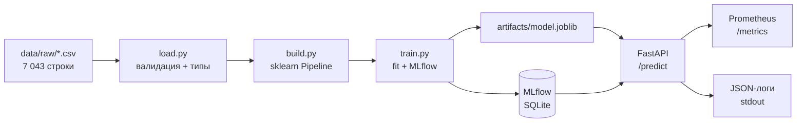

# Telco Churn MLE Service

[](https://github.com/GavrilenkoVsevolod/telco-churn-mle/actions/workflows/ci.yml)
[](https://www.python.org/downloads/release/python-3118/)
[](https://github.com/astral-sh/ruff)
[](https://opensource.org/licenses/MIT)

End-to-end ML-сервис для предсказания оттока клиентов телеком-оператора.
От сырых данных до Docker-контейнера с HTTP API, мониторингом и CI.

**Baseline (LogisticRegression):** ROC-AUC **0.8414** · PR-AUC 0.6324 · F1 0.6130 · Precision 0.5034 · Recall 0.7834

---

## Архитектура



**Поток данных:**

1. `load.py` — читает CSV, конвертирует `TotalCharges` в numeric, кодирует target `Yes/No → 1/0`, валидирует схему
2. `build.py` — собирает `Pipeline(ColumnTransformer + LogisticRegression)`: препроцессинг и модель в **одном объекте**
3. `train.py` — обучает, логирует параметры/метрики/модель в MLflow, сохраняет `artifacts/model.joblib`
4. `serve/app.py` — грузит модель при старте, отдаёт `/predict`, `/health`, `/metrics`, `/model-info`
5. `monitoring.py` — метрики Prometheus + JSON-логи каждого предсказания

---

## Быстрый старт

### Локально (WSL2 / Linux / macOS)

```bash
# 1. Зависимости
uv sync

# 2. Данные (скачай с Kaggle и положи в data/raw/)
# https://www.kaggle.com/datasets/blastchar/telco-customer-churn
# файл: WA_Fn-UseC_-Telco-Customer-Churn.csv

# 3. Обучение (создаст artifacts/model.joblib и mlflow.db)
uv run python -m src.train

# 4. Тесты
uv run pytest -v

# 5. API
uv run uvicorn src.serve.app:app --port 8000
# Swagger: http://localhost:8000/docs

# 6. MLflow UI
uv run mlflow ui --port 5000
# http://localhost:5000
```

### Docker Compose (весь стек)

```bash
docker compose up --build -d
```

| Сервис | URL | Назначение |
|---|---|---|
| API | http://localhost:8000/docs | FastAPI + Swagger |
| MLflow | http://localhost:5000 | Трекинг экспериментов |
| Prometheus | http://localhost:9090 | Метрики |

---

## API

### `POST /predict` — предсказание вероятности оттока

```bash
curl -X POST http://localhost:8000/predict \
  -H "Content-Type: application/json" \
  -d '{
    "tenure": 2, "MonthlyCharges": 95.0, "TotalCharges": 190.0,
    "gender": "Male", "SeniorCitizen": 0, "Partner": "No", "Dependents": "No",
    "PhoneService": "Yes", "MultipleLines": "Yes", "InternetService": "Fiber optic",
    "OnlineSecurity": "No", "OnlineBackup": "No", "DeviceProtection": "No",
    "TechSupport": "No", "StreamingTV": "Yes", "StreamingMovies": "Yes",
    "Contract": "Month-to-month", "PaperlessBilling": "Yes",
    "PaymentMethod": "Electronic check"
  }'
```

Ответ:

```json
{"churn": true, "probability": 0.8234, "model_version": "local-joblib-v1"}
```

### Остальные эндпоинты

| Метод | Путь | Назначение |
|---|---|---|
| GET | `/health` | Liveness-проба (Docker healthcheck) |
| GET | `/metrics` | Prometheus-метрики |
| GET | `/model-info` | Метаданные модели (run_id, метрики из MLflow) |

**Метрики Prometheus:**
- `churn_predictions_total{churn="true|false"}` — счётчик предсказаний по классам
- `churn_prediction_latency_seconds` — гистограмма latency
- `churn_probability` — гистограмма предсказанных вероятностей (для детекции дрифта)

---

## Стек и обоснование выбора

| Слой | Выбор | Почему |
|---|---|---|
| Модель | LogisticRegression + OneHotEncoder | Baseline, интерпретируемый, быстрый. Для табличных данных с категориями — сильный старт. XGBoost/LightGBM — следующий шаг после фиксации baseline |
| Препроцессинг | `sklearn.Pipeline` | Модель + энкодеры — **один объект**. Невозможно «забыть применить трансформацию» на инференсе |
| Трекинг | MLflow 3.18 + SQLite | Воспроизводимость экспериментов. File store deprecated в 3.x, SQLite — оптимум для одного разработчика. Postgres — когда появится команда |
| API | FastAPI 0.162 + Pydantic 2.14 | Автогенерация OpenAPI, валидация «из коробки» |
| Упаковка | Docker multi-stage + `COPY --chown` | В runtime нет `uv` и build-зависимостей, образ ~1.07 ГБ |
| Метрики | prometheus-client 0.26 | Стандарт индустрии. `churn_probability` — гистограмма для дрифта |
| CI | GitHub Actions | Lint + test + docker build на каждый push. `train.py` в CI — integration-тест всего пайплайна |
| Менеджер пакетов | uv | Быстрее pip, lock-файл, автоматическая установка Python |

**Версии:** Python 3.11.18 · scikit-learn 1.9.1 · FastAPI 0.162.5 · MLflow 3.18.0 · Pydantic 2.14.3 · prometheus-client 0.26.0

---

## Метрики и данные

**Датасет:** [Telco Customer Churn](https://www.kaggle.com/datasets/blastchar/telco-customer-churn)

- 7 043 строки, 21 колонка (20 фичей + target)
- Target: `Churn` (Yes/No), **26.54%** положительных (1 869 / 7 043)
- Дисбаланс классов → `class_weight='balanced'` в модели

**Baseline (LogisticRegression, `class_weight='balanced'`, `random_state=42`, test_size=0.2):**

| Метрика | Значение |
|---|---|
| ROC-AUC | **0.8414** |
| PR-AUC | 0.6324 |
| F1 | 0.6130 |
| Precision | 0.5034 |
| Recall | 0.7834 |

**Почему recall важнее precision:** пропустить «уходящего» клиента дороже, чем зря предложить скидку. `class_weight='balanced'` сдвигает порог в сторону recall.

---

## Мониторинг

- **`/metrics`** — Prometheus-метрики: `churn_predictions_total`, `churn_prediction_latency_seconds`, `churn_probability`
- **JSON-логи** каждого предсказания в stdout (поле `event`): `churn`, `probability`, `tenure`, `monthly_charges`, `contract`
- **Prometheus** в compose: `docker compose up --build -d` → http://localhost:9090

---

## Скриншоты

> ⚠️ **TODO:** добавить после запуска стека.
> 1. `docs/swagger.png` — http://localhost:8000/docs
> 2. `docs/mlflow.png` — http://localhost:5000 (эксперимент `telco-churn`)
> 3. `docs/prometheus.png` — http://localhost:9090 (график `churn_predictions_total`)

---

## Структура проекта

```
.
├── src/
│   ├── data/load.py            # загрузка + валидация
│   ├── features/build.py       # sklearn Pipeline
│   ├── train.py                # обучение + MLflow
│   └── serve/
│       ├── app.py              # FastAPI
│       ├── schemas.py          # Pydantic-схемы
│       └── monitoring.py       # Prometheus + JSON-логи
├── tests/test_api.py           # 8 тестов API
├── Dockerfile                  # multi-stage
├── docker-compose.yml          # api + mlflow + prometheus
├── prometheus.yml
├── pyproject.toml              # uv + ruff + pytest
└── .github/workflows/ci.yml    # lint + test + docker build
```

---

## Тесты и CI

```bash
uv run pytest -v          # 8 passed
uv run ruff check .       # All checks passed!
uv run ruff format --check .
```

CI (`.github/workflows/ci.yml`) на каждый push:
1. `uv sync --frozen`
2. `uv run python -m src.train` — integration-тест всего пайплайна
3. `ruff check` + `ruff format --check`
4. `pytest -v`
5. `docker build`

---

## Что бы улучшил в проде

Это baseline, не финальная система. Осознанные ограничения:

1. **Модель.** LogisticRegression — потолок ~0.84 ROC-AUC. XGBoost/LightGBM дадут +1–2 п.п., но потеряют интерпретируемость. SHAP для объяснения предсказаний — следующий шаг.
2. **Данные.** 7 043 строки — маленький датасет. В проде — поток из CRM, feature store (Feast), версионирование через DVC.
3. **Model Registry.** Сейчас модель грузится из `artifacts/model.joblib`. В проде — `models:/churn/Production` из MLflow Registry, промоушен по стадиям, откат.
4. **Дрифт.** `churn_probability` — гистограмма, но нет алертов. Evidently AI / WhyLabs для детекции data drift и model drift.
5. **Retraining.** Ручной `uv run python -m src.train`. В проде — cron/GitHub Actions schedule + авто-промоушен, если метрики лучше прода.
6. **Образ Docker.** Сейчас ~1.07 ГБ. Дальнейшая оптимизация: убрать `mlflow` из runtime (он нужен только для `/model-info`), distroless-база, `--no-cache`.
7. **Секреты.** `.env` локально. В проде — Vault / AWS Secrets Manager.
8. **Мониторинг.** Prometheus есть, но нет Grafana-дашборда и алертов (Alertmanager).
9. **Тесты.** 8 API-тестов + integration. Нет unit-тестов на `features/`, нет property-based (hypothesis), нет нагрузочных (locust).
10. **Деплой.** Docker compose локально. В проде — k8s / ECS, CI/CD с пушем в registry (GHCR/ECR).

---

## Лицензия

MIT — см. [LICENSE](LICENSE).

Данные — [Kaggle: Telco Customer Churn](https://www.kaggle.com/datasets/blastchar/telco-customer-churn), лицензия датасета — Apache 2.0.